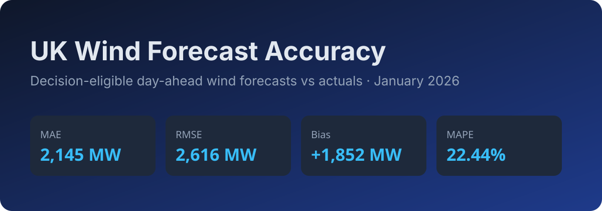

# UK Wind Forecast Accuracy (Day-Ahead)



National-level UK wind generation: decision-time forecasts vs actuals for **January 2026**.

- Live app: https://frontend-mu-beige-39.vercel.app
- API: https://backend-ten-chi-59.vercel.app
- Repo: https://github.com/RavaniRoshan/a9lfb4

## What it does

1. Shows the renewable (wind) forecast available **at decision time** (day-ahead gate, default 09:10 UTC previous day).
2. Quantifies forecast error: MAE, RMSE, bias, MAPE overall and by day, hour, and horizon.

A forecast is only usable if it existed at decision time. The app uses the WINDFOR vintage with the greatest `publishTime <= decision_time`, never the latest on record.

## Quickstart

```bash
docker compose up --build
```

Frontend: http://localhost:8080 · Backend: http://localhost:8000

Dev:

```bash
cd backend && pip install -r requirements.txt && OFFLINE=1 CACHE_DIR=../data/cache uvicorn app.main:app --reload --port 8000
cd frontend && npm install && npm run dev
```

## Tests

```bash
cd backend && pytest -q
cd frontend && npm test && npm run lint && npm run build
```

## Deployment

See [DEPLOYMENT.md](DEPLOYMENT.md).

## Repository layout

```
backend/   FastAPI app, pipeline, metrics, tests, Dockerfile
frontend/  React (Vite) views, Dockerfile, nginx, Vercel config
docker-compose.yml
```

## Scope and data

- National UK wind only, Elexon data alone (FUELHH actuals, WINDFOR forecasts).
- January 2026 delivery window. No database, no auth, no secrets.

## AI tools disclosure

Built with assistance from an AI coding agent (Kilo/Beam, Claude Code) for scaffolding, refactoring, tests, and documentation. HyperFrames was used to author and render the demo video. All generated code was reviewed and tested by the author.
